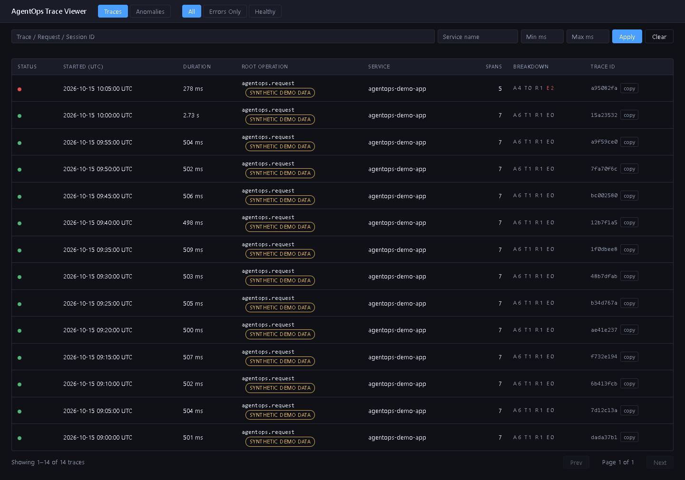
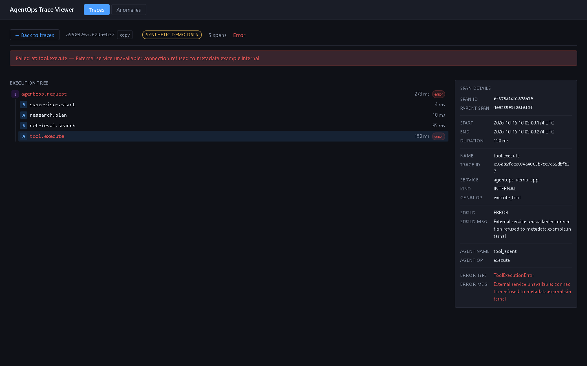
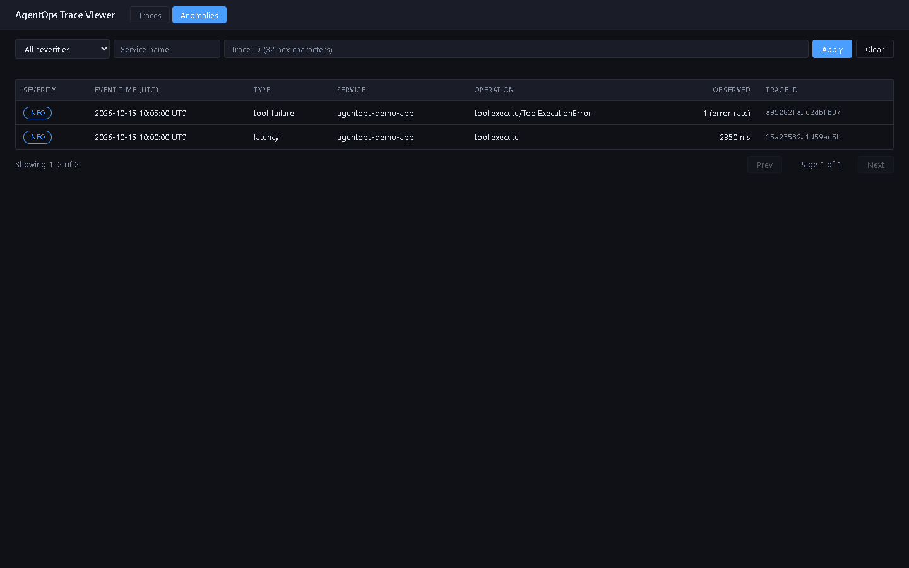
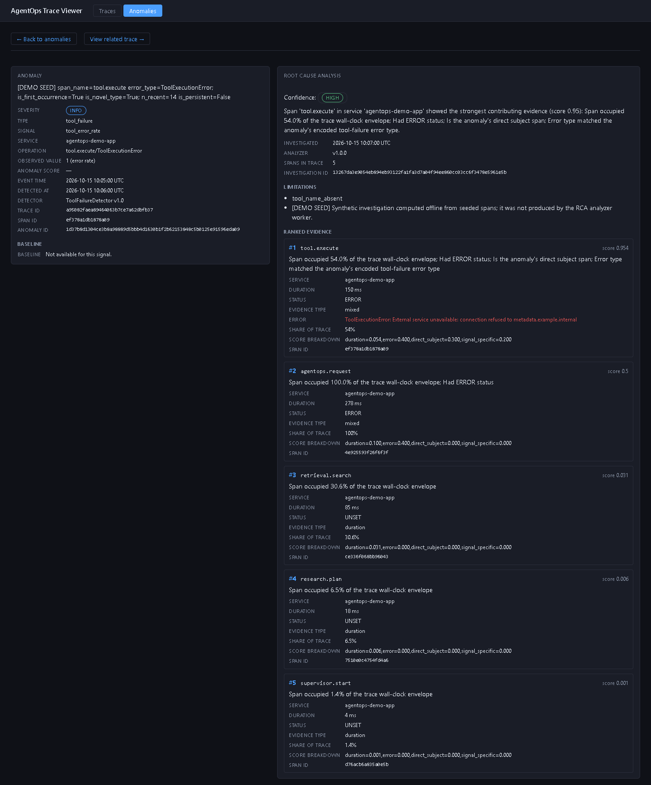

# AgentOps Intelligence Platform

AgentOps Intelligence Platform is a local observability and diagnosis pipeline for understanding why AI-agent runs
fail or slow down. It collects OpenTelemetry traces from an agent, streams them through an OTLP Collector and
Kafka, processes them in Python, stores them in PostgreSQL, models them with dbt, flags latency, error-rate and
tool-failure anomalies, produces an evidence-backed root-cause-analysis (RCA) investigation for a chosen anomaly,
and shows the result in a read-only local Trace Viewer.

**Status: a validated local MVP, exercised with synthetic workloads.** It is not a production-ready or
commercial platform, and nothing here claims production readiness, production-scale throughput, scalability or
a measured RCA accuracy. The Trace Viewer is a local, unauthenticated tool; it is not a hosted public showcase,
and no public demo exists. The source code is publicly available on GitHub; this repository is not a hosted
application or a production deployment, and it does not claim a formal GitHub Release. See
[Limitations](#limitations) before relying on any part of it.

**Where to go:** [architecture](docs/ARCHITECTURE.md), [setup and operations](docs/SETUP-AND-OPERATIONS.md),
[validation and residual risks](docs/VALIDATION-AND-ACCEPTANCE.md), [license](#license).

## The problem

Agent runs fail or slow down in ways that are hard to see from logs alone: a tool call errors repeatedly, a step
takes far longer than usual, a trace is incomplete. This project asks a narrow, testable question: given
telemetry from an agent, can a small pipeline of ordinary components detect that something is wrong, point at
the span responsible, and present the evidence next to the trace? The workload is synthetic and deterministic,
so every result can be checked against a plan.

## Architecture in one picture

```text
Synthetic agent / workload -> OpenTelemetry -> OTLP Collector -> Kafka -> stream processing / storage
    -> PostgreSQL + dbt -> anomaly detection -> RCA investigation and evidence -> Trace Viewer
```

Details, source files and a component-status matrix are in [docs/ARCHITECTURE.md](docs/ARCHITECTURE.md).

## What you can explore

The repository contains the code and offline tests for each stage below. These are engineering capabilities
exercised by the code and by a local, synthetic validation, not measured business outcomes. Which stages ran in the
live validation is recorded in [Component status](#component-status) and in
[docs/VALIDATION-AND-ACCEPTANCE.md](docs/VALIDATION-AND-ACCEPTANCE.md).

1. **Synthetic agent telemetry.** A deterministic synthetic workload drives an instrumented agent that emits
   OpenTelemetry spans with `gen_ai.*` and `agentops.*` attributes over OTLP gRPC
   ([workload-generator/](workload-generator/), [demo-app/](demo-app/)).
2. **Span processing.** Spans pass through the OTLP Collector to Kafka, and a stream processor converts them to
   canonical span records and routes invalid records to a dead-letter topic
   ([collector/](collector/), [stream-processor/](stream-processor/)).
3. **Storage and trace reconstruction.** A storage consumer writes the spans to PostgreSQL, and dbt models group
   them into traces and trace-level metrics ([storage-consumer/](storage-consumer/),
   [db-bootstrap/](db-bootstrap/), [analytics/](analytics/)).
4. **Anomaly detection.** A one-shot detector flags latency, error-rate and tool-failure anomalies
   ([anomaly-detector/](anomaly-detector/)).
5. **Evidence-backed root-cause analysis.** The analyzer investigates one anomaly by id and stores ranked evidence
   ([rca-analyzer/](rca-analyzer/)). A confidence label such as HIGH is the analyzer's output for that
   investigation, not a measured accuracy.
6. **Local Trace Viewer.** A read-only, unauthenticated, loopback-only web interface for traces, anomalies and RCA
   ([trace-viewer/](trace-viewer/), [docker/trace-viewer/README.md](docker/trace-viewer/README.md)).

Around the pipeline, the deterministic workload can be checked against a plan, and a pinned harness reconciles each
stage on a disposable Docker Compose project and cleans up afterwards. That harness is pinned to one Windows
machine; see [Limitations](#limitations).

## Platform Walkthrough

> **All screenshots use synthetic demonstration data. The displayed anomaly events and root-cause investigations are
> precomputed demonstration records, not evidence of a live production detection or automated RCA run.**

The four screenshots below show the local Trace Viewer on a small, deterministic synthetic dataset (14 traces, 96
spans, 2 anomaly events and 2 RCA investigations). They were captured from a local, isolated instance. This dataset is
separate from the Phase 14.7 runs and from the accepted local Viewer dataset described under
[Validation status](#validation-status), and its counts are not combined with theirs. The screenshots show what the
viewer displays; they do not show a production deployment, a hosted service, a live anomaly-inference run or a live
automated RCA execution.

### 1. Observability Dashboard



The trace overview lists the synthetic traces with a status indicator (one trace has errors, the others are healthy),
start time, duration, root operation, service, span count and a per-trace span breakdown. Every row carries a
"Synthetic Demo Data" tag. The Traces and Anomalies tabs, the filters and the search fields lead into an investigation,
and selecting a row opens that trace.

### 2. Trace Investigation



A trace opens as an execution tree of its spans. In this synthetic trace the `tool.execute` span failed after 150 ms. The
failure banner names that span, the span is selected in the tree, and the span-details panel shows its identifiers,
timing, status, agent attributes and the recorded error type and message. The failure text refers to a synthetic host
name.

### 3. Anomaly Detection



The anomaly list shows two synthetic anomaly events: a tool failure on `tool.execute` and a latency anomaly on the same
operation (2350 ms observed). Both are listed with severity, event time, service, operation, observed value and the
related trace ID. Both records are precomputed demonstration data.

### 4. Evidence-Backed Root-Cause Analysis



The anomaly detail view pairs the anomaly with its investigation: an investigation summary, a confidence label (HIGH),
the recorded limitations (including a note that the investigation is synthetic and was computed offline from seeded
spans, not produced by the RCA analyzer worker) and five ranked supporting evidence spans, each with its score, score
breakdown and span details. As noted under [What you can explore](#what-you-can-explore), a confidence label such as
HIGH is not a measured accuracy.

## Component status

| Component | Implemented | Included in the successful end-to-end runs |
|---|---|---|
| Synthetic workload ([workload-generator/](workload-generator/), [demo-app/](demo-app/)) | yes | yes |
| OpenTelemetry instrumentation and OTLP Collector ([collector/](collector/)) | yes | yes |
| Kafka, stream processor, storage consumer ([stream-processor/](stream-processor/), [storage-consumer/](storage-consumer/)) | yes | yes |
| PostgreSQL bootstrap and dbt ([db-bootstrap/](db-bootstrap/), [analytics/](analytics/)) | yes | yes |
| Anomaly detector ([anomaly-detector/](anomaly-detector/)) | yes | yes |
| RCA analyzer ([rca-analyzer/](rca-analyzer/)) | yes | yes (Step 5F) |
| Trace Viewer API ([trace-viewer/](trace-viewer/)) | yes | yes, in-process (Step 5F) |
| Standalone Viewer Compose overlay, Grafana, alerting, incident retrieval | yes | **no** |

"Implemented" means the code and its offline tests exist. "Included in the successful end-to-end runs" means it
ran in the Phase 14.7 live validation described in
[docs/VALIDATION-AND-ACCEPTANCE.md](docs/VALIDATION-AND-ACCEPTANCE.md).

*Terminology.* "Phase 14.7" is the project's internal name for its live end-to-end validation: two accepted local
runs, Step 4F (through anomaly detection) and Step 5F (adding the RCA analyzer and the Trace Viewer API).
`B3J-###` identifiers in code comments and some documents are internal ticket references.

**OpenInference is not implemented.** The repository contains no OpenInference dependency or reference. Spans are
produced with the OpenTelemetry SDK and carry `gen_ai.*` and `agentops.*` attributes.

## Validation status

Phase 14.7 ran the whole chain twice (Step 4F and Step 5F) on a disposable Docker Compose project, each time ending
in a verified cleanup. Each run sent 110 synthetic requests, stored 746 spans, detected 42 anomaly events and re-ran the
detector without inserting duplicates. The second run also investigated one CRITICAL tool-failure anomaly
(five evidence rows, repeated without duplication) and checked it through the Trace Viewer API. These are
reported historical results from the project owner's accepted local runs. The underlying evidence archive is
private and is not distributed with this repository, so the figures cannot be reproduced from a fresh clone. The
residual-risk register is in [docs/VALIDATION-AND-ACCEPTANCE.md](docs/VALIDATION-AND-ACCEPTANCE.md).

The accepted local Viewer dataset (38 traces, 2 anomalies, one HIGH-confidence RCA investigation with five
evidence rows) comes from the project owner's separately accepted local Viewer instance, which is a different
dataset from these end-to-end runs; its counts are not combined with theirs.

This is successful end-to-end validation of a local MVP on one pinned Windows and Docker Desktop environment. It
is not a certification of production readiness.

## Getting started

[docs/SETUP-AND-OPERATIONS.md](docs/SETUP-AND-OPERATIONS.md) lists prerequisites, configuration, ports, startup
and shutdown, and troubleshooting. There is no validated one-command start, and no fresh-clone startup procedure
has been verified. Several setup paths there are source-derived and labelled unverified. The live end-to-end harness
([workload-generator/run_e2e.py](workload-generator/run_e2e.py)) is pinned to a specific machine and is not an
installer.

## Limitations

- **Security.** Everything is for a single machine. Published ports are bound to `127.0.0.1`, which restricts
  where a connection can come from but is not authentication. The Trace Viewer has no authentication. In the
  optional pipeline overlay the storage consumer connects as the PostgreSQL owner role.
- **Portability.** The validated workflow is Windows-first. The live end-to-end harness
  ([workload-generator/run_e2e.py](workload-generator/run_e2e.py)) is pinned to the original developer machine's
  Docker engine, protected containers and volumes, Git branch and approved-tree manifest. It is included to
  document how the validation was done, and it refuses to run elsewhere until that code is edited deliberately.
  The retained E2E validation harness is machine-pinned and is not a portable fresh-clone installer.
  A CI workflow is deferred from the initial public release, so no CI result is claimed.
- **Source state.** The source code is publicly available on GitHub as a clean source tree on the `main` branch,
  without the development repository's Git history. Public source availability is distinct from a formal GitHub
  Release, a hosted application and a production deployment; this repository claims none of those, and the
  validation results above come from local runs only.
- **Scale.** The benchmark and recovery work ([benchmarks/](benchmarks/),
  [workload-generator/PHASE-14.5-FAILURE-RECOVERY.md](workload-generator/PHASE-14.5-FAILURE-RECOVERY.md)) covers
  small synthetic workloads on one laptop and supports no production-capacity claim.

## Documentation

- [docs/ARCHITECTURE.md](docs/ARCHITECTURE.md): pipeline, components, source files and status
- [docs/SETUP-AND-OPERATIONS.md](docs/SETUP-AND-OPERATIONS.md): environment, startup, shutdown, troubleshooting
- [docs/VALIDATION-AND-ACCEPTANCE.md](docs/VALIDATION-AND-ACCEPTANCE.md): Phase 14.7 results and residual risks
- [docker/trace-viewer/README.md](docker/trace-viewer/README.md): the Trace Viewer demonstration
- [.env.example](.env.example): the credential template (every value is intentionally empty)

## License

AgentOps-owned source code is licensed under the Apache License, Version 2.0; see [LICENSE](LICENSE). Third-party
dependencies and model weights are not covered by that license and keep their own licenses; see
[THIRD-PARTY-LICENSES.md](THIRD-PARTY-LICENSES.md) for the reviewed inventory. That review is not an exhaustive
audit.
