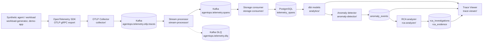

# Architecture

This document describes the pipeline as it exists in the repository, and separates what ran in the live
validation from what is merely implemented. Status words are used consistently:

- **Live-validated**: ran in the Phase 14.7 end-to-end runs (Step 4F and Step 5F; see
  [VALIDATION-AND-ACCEPTANCE.md](VALIDATION-AND-ACCEPTANCE.md)).
- **Implemented, not live-validated**: code and offline tests exist; it was not part of those runs.

## Pipeline

The Collector is configured with an OTLP receiver and a Kafka exporter (`otlp_proto` encoding) in
[collector/otel-collector-config.yaml](../collector/otel-collector-config.yaml). The three Kafka topics, each
with three partitions, are created by the `kafka-init` service in [docker-compose.yml](../docker-compose.yml).

## Component status

| Component | Responsibility | Main sources | Implemented | Live-validated | Known limitations |
|---|---|---|---|---|---|
| Synthetic workload | Plans a deterministic set of agent requests (normal, slow-tool, repeated-failure) and runs them through the demo agent | [workload-generator/workload_generator/](../workload-generator/workload_generator/), [demo-app/](../demo-app/) | yes | yes | Synthetic only; a send is refused without an explicit endpoint |
| OpenTelemetry export | Emits spans with `gen_ai.*` and `agentops.*` attributes over OTLP gRPC | [demo-app/](../demo-app/) | yes | yes | **No OpenInference**; none is referenced anywhere in the repository |
| OTLP Collector | Receives OTLP and forwards it to Kafka | [collector/otel-collector-config.yaml](../collector/otel-collector-config.yaml) | yes | yes | Keeps a `debug` exporter (committed at `basic` verbosity); no redaction |
| Kafka | Buffers raw, canonical and dead-letter topics | [docker-compose.yml](../docker-compose.yml) | yes | yes | Single broker, replication factor 1, unauthenticated, loopback-bound |
| Stream processor | Converts raw OTLP records to canonical span records; invalid records go to the DLQ | [stream-processor/](../stream-processor/) | yes | yes (as a host process) | The container form is the overlay [docker/compose.pipeline.yml](../docker/compose.pipeline.yml), which its own header calls unverified beyond one earlier run |
| Storage consumer | Writes canonical spans to PostgreSQL | [storage-consumer/](../storage-consumer/) | yes | yes (as a host process) | Connects as the PostgreSQL owner role; exact-count checks are sensitive to redelivery |
| PostgreSQL and bootstrap | Builds schema, roles and grants from an empty database with a ledger of 18 steps | [db-bootstrap/](../db-bootstrap/), [storage-consumer/migrations/](../storage-consumer/migrations/) | yes | yes | A database without a bootstrap ledger is refused (exit code 5) |
| dbt analytics | Builds the staging, intermediate and mart models and re-applies grants | [analytics/](../analytics/), [db-bootstrap/analytics_refresh.py](../db-bootstrap/analytics_refresh.py) | yes | yes | Run only through `analytics-refresh`; running dbt directly drops grants |
| Anomaly detector | Latency, error-rate, tool-failure and retrieval-quality detectors, run as a one-shot command | [anomaly-detector/](../anomaly-detector/) | yes | yes (latency, error rate, tool failure) | Retrieval-quality detection was not exercised. `observed_value` is not a rate for error signals |
| RCA analyzer | Investigates one anomaly by id and stores ranked evidence; idempotent | [rca-analyzer/](../rca-analyzer/) | yes | yes (Step 5F) | One anomaly was investigated in the live run |
| Trace Viewer API | Read-only FastAPI service for traces, anomalies and RCA | [trace-viewer/](../trace-viewer/) | yes | yes, driven in-process (Step 5F) | No authentication; a separate server was not started in the run |
| Standalone Viewer overlay | Runs the Viewer as a Compose service | [docker/compose.trace-viewer.yml](../docker/compose.trace-viewer.yml) | yes | **no** | Only validated with `docker compose config`; see [the Viewer README](../docker/trace-viewer/README.md) |
| Grafana | Dashboards over PostgreSQL | [grafana/](../grafana/), [docker-compose.yml](../docker-compose.yml) | yes | **no** | Not exercised in the validation |
| Alerting | Alert evaluation and notification | [alerting/](../alerting/) | yes | **no** | Offline tests only |
| Incident retrieval | Embedding-based retrieval over past investigations | [incident-retrieval/](../incident-retrieval/) | yes | **no** | Needs a large model stack; offline tests only |

## The four layers of the repository

1. **Implemented MVP.** The chain in the diagram, from the workload to the Trace Viewer.
2. **Optional end-to-end harness.** [workload-generator/run_smoke.py](../workload-generator/run_smoke.py) and
   [workload-generator/run_e2e.py](../workload-generator/run_e2e.py) build a disposable Compose project, run the
   workload through the whole chain, reconcile every stage, and clean up. The opt-in flag `--with-rca-viewer`
   adds the RCA and Viewer stage. The harness is pinned to one Docker engine and a set of protected resources,
   and is not a general installer.
3. **Accepted-MVP tooling.** [docker/mvp/](../docker/mvp/), [docker/mvp-workers/](../docker/mvp-workers/),
   [docker/mvp-workers-pipetest/](../docker/mvp-workers-pipetest/) and the `scripts/agentops_mvp*.py` helpers
   support separate, isolated Compose projects. They are not part of the end-to-end runs.
4. **Historical work.** Phase 14.4 benchmarks ([benchmarks/README.md](../benchmarks/README.md),
   [benchmarks/RESULTS.md](../benchmarks/RESULTS.md)), the Phase 14.5 recovery study
   ([PHASE-14.5-FAILURE-RECOVERY.md](../workload-generator/PHASE-14.5-FAILURE-RECOVERY.md), a limited-closure
   draft). Unexecuted impact-benchmark experiments from the development repository are not included in this
   release. These support no production-capacity claim.

## Data model, briefly

- Raw spans land in `public.telemetry_spans`; dbt builds the `analytics` models used by the detector and the
  Viewer.
- Anomalies are stored in `public.anomaly_events`; investigations and evidence in `public.rca_investigations`
  and `public.rca_evidence`. Each application role has only the grants it needs (for example, the RCA analyzer
  can read anomalies and spans and insert only into the two RCA tables; the Viewer role can only read).
- RCA investigation ids are deterministic, so running the analyzer again for the same anomaly inserts nothing.

## What this architecture does not claim

- It does not claim OpenInference instrumentation.
- It does not claim production readiness, multi-host operation, authentication, or capacity beyond the small
  workloads recorded in the benchmark documents.
- Grafana, alerting, incident retrieval and the standalone Viewer deployment are not presented as end-to-end
  validated.
